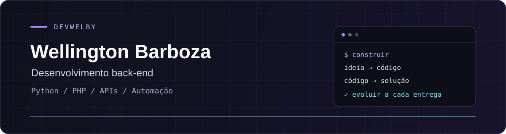

# Wellington Barboza

**Desenvolvimento back-end · Python & PHP · APIs & automação**

Crio sistemas web e integrações para transformar necessidades em soluções úteis.

[Portfólio](https://wellingtonbarboza.com/) · [LinkedIn](https://www.linkedin.com/in/wellington-d-barboza/) · [E-mail](mailto:contato@wellingtonbarboza.com)

---

## Sobre mim

Sou desenvolvedor back-end em Pernambuco, Brasil. Meu foco está em **Python e PHP**, com projetos que também usam **Node.js**, bancos de dados e integrações com serviços externos.

Meu trabalho reúne sistemas de gestão, processamento de imagens, aplicações financeiras e diagnóstico de redes. Também desenvolvo soluções com IA aplicada, conectando modelos e serviços a fluxos de uso concretos.

Além dos exemplos públicos abaixo, desenvolvo **projetos de código fechado** com PHP e Python, envolvendo arquitetura MVC, autenticação e controle de acesso, cache e automações agendadas. Esses repositórios permanecem privados.

**O que você encontra por aqui**

- **Back-end:** autenticação, regras de negócio, APIs, uploads e relatórios.
- **Dados e integrações:** MySQL, processamento em lote e integração com serviços de IA e pagamentos.
- **Infraestrutura e operação:** configuração por ambiente, processos com PM2, healthchecks e publicação com GitHub Actions.

## Projetos selecionados

| Projeto | Aplicação | Tecnologias |
| :--- | :--- | :--- |
| [**Lumina Studio**](https://github.com/devWelby/LUMINA-STUDIO) | Processamento de imagens com upload individual ou em lote, comparação antes/depois e exportação em ZIP. | Python · FastAPI · OpenCV |
| [**Sistema LMS**](https://github.com/devWelby/Sistema-Lms) | Plataforma de estudos com autenticação, trilhas, avaliações, biblioteca e painel administrativo. | PHP · MySQL · PDO |
| [**Aura AI**](https://github.com/devWelby/Aura-ai) | Aplicação de análise financeira com upload de extratos, relatórios e assinatura. Inclui testes HTTP e rotinas de operação. | Node.js · Express · MySQL · Stripe |
| [**NetGamer Diagnostics**](https://github.com/devWelby/netchek) | Diagnóstico de rede com medições de latência, download/upload, gráficos e relatórios em PDF. | Node.js · WebSocket · JavaScript |

[Explorar todos os repositórios públicos →](https://github.com/devWelby?tab=repositories&type=source)

## Tecnologias

**Foco principal:** Python · PHP  
**Back-end e dados:** FastAPI · Node.js · Express · MySQL  
**Automação e imagens:** OpenCV · NumPy  
**Web:** JavaScript · HTML · CSS  
**Workflow e operação:** Git · GitHub · GitHub Actions · PM2 · Apache · cPanel

## Como organizo as entregas

Nos projetos públicos, o workflow inclui:

- **Configuração documentada:** instruções de execução e variáveis de ambiente.
- **Verificação antes do envio:** checagens de sintaxe, testes HTTP e auditoria de segredos no [Aura AI](https://github.com/devWelby/Aura-ai).
- **Operação acompanhável:** healthcheck e gerenciamento de processos com PM2 no Aura AI.
- **Publicação automatizada:** workflow do GitHub Actions no [portfólio](https://github.com/devWelby/WellingtonBarboza).

## Vamos conversar

Para conversar sobre sistemas web, APIs, integrações ou automação:

**[contato@wellingtonbarboza.com](mailto:contato@wellingtonbarboza.com)**  
[LinkedIn](https://www.linkedin.com/in/wellington-d-barboza/) · [wellingtonbarboza.com](https://wellingtonbarboza.com/)
